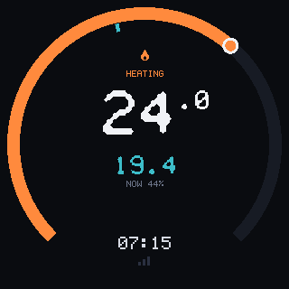

# J49 emulator

The screen of the [J49 thermostat software](https://github.com/wian007/nest-yocto) on a PC, in
the browser: for trying the user interface, a language file or a theme without a thermostat.

It runs the real screen program (`j49-screen`, built for the PC) with a file as its frame
buffer and two pipes as the ring, and serves a page that shows the round screen. The mouse
wheel or the arrow keys turn the ring; a click, Enter or the space bar presses it. The
thermostat behind the screen is simulated by `j49-screen` itself: a room of 19.4 degrees and
a heating that follows the target.

## Use

Linux, Python 3 (standard library only) and a Rust toolchain for the one-time build.

    git clone https://github.com/wian007/nest-yocto
    (cd nest-yocto/tools/j49-screen && cargo build --release)
    python3 emu.py --screen nest-yocto/tools/j49-screen/target/release/j49-screen
    # open http://localhost:8050/

With the Nix shell of nest-yocto the binary is in
`target/x86_64-unknown-linux-gnu/release/j49-screen`.

Options: `--port 8050`, `--lang en|nl`, `--theme default|home-assistant|light`. Language and
theme can also be changed on the page, and in the Settings of the emulated thermostat.

Your own language or theme: `j49-screen` reads `/var/lib/j49/lang/<code>.txt` and
`/var/lib/j49/themes/<name>.theme` when they exist (see `docs/thermostat.md` in nest-yocto);
start the emulator with `--lang <code>` or `--theme <name>`.

## What it is not

- It shows the screen program only. The web page of the thermostat, MQTT and the control loop
  are other programs; they are not part of it.
- Settings are not kept: the emulated thermostat starts fresh each time.
- The server listens on localhost only and has no login. Do not expose it.

## Licence

[MIT](LICENSE). Not affiliated with Google or Nest.
